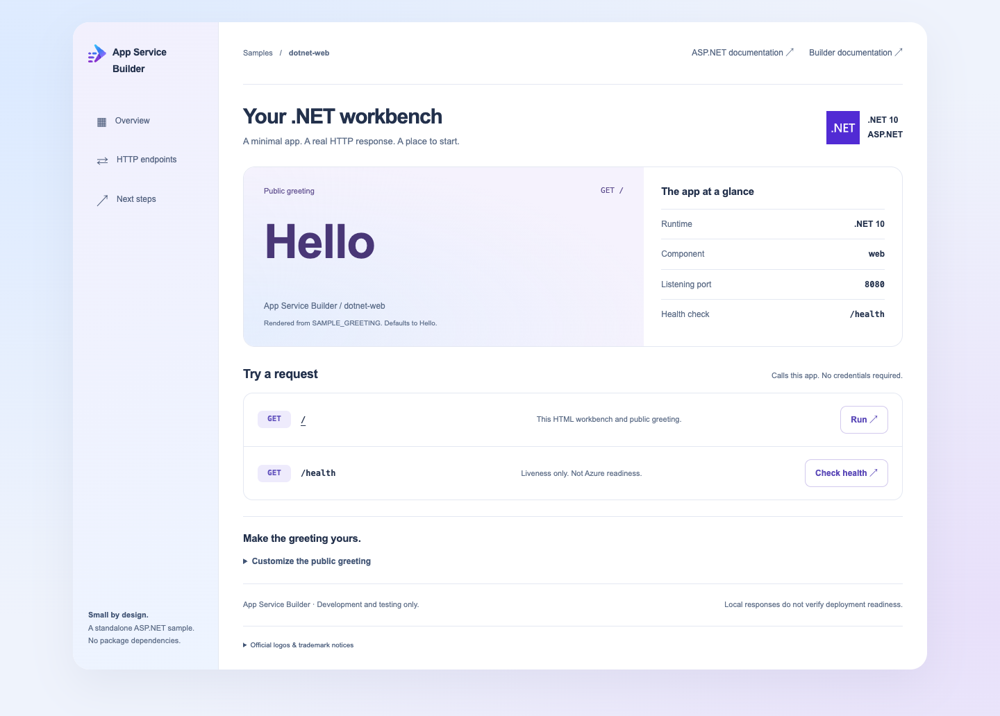

# App Service Builder: ASP.NET HTTP sample

A standalone, minimal ASP.NET app for learning how to deploy committed GitHub
source with [App Service Builder](https://builder.appservice.azure.com/docs/). The app
targets .NET 10 and has no NuGet package dependencies.

## Preview

The visual workbench is served directly at `/`, without a redirect.



Real local rendering in Microsoft Edge, not evidence of an Azure deployment.
ASP.NET documentation is separate from Builder documentation. **Customize the
public greeting** discloses the source variable `SAMPLE_GREETING`; it does not
infer your fork or edit your deployment.

**App Service Builder is in Private Preview. Use this sample for development and
testing, not production.** Local validation does not establish preview runtime
availability or end-to-end deployment readiness. A live preview deployment of
this sample has not been qualified.

## Features

| Endpoint | Response |
| --- | --- |
| `GET /` | HTTP 200, `text/html; charset=utf-8`, responsive .NET workbench displaying the public greeting |
| `GET /health` | HTTP 200, `OK` followed by a newline |
| Unknown path | HTTP 404 |

`SAMPLE_GREETING` changes the deliberately public greeting. The app does not
require credentials or expose environment diagnostics. `builder.yaml` describes
one .NET 10 web component, listening on port 8080 with `/health` as its health
check. The manifest relies on Builder defaults for root routing, port 8080, and
HTTP 200 as the successful health-check status.

Open `/` for the visual showcase and template thumbnail view. It uses
self-contained HTML, CSS, and JavaScript with no external assets or packages.
The request buttons fetch the actual endpoints and display their status and content
type. The root request summarizes the returned HTML title and public greeting;
the health request shows the exact text body. HTML is parsed without executing it
and the summary is inserted as text. Errors remain visible; the page does not
report deployment status. The root link remains usable without JavaScript; inspect `/health` with curl when scripts are off. The health control stays inline, with visible errors and retry via the same button.

## Getting Started

### Prerequisites

- Git and a [.NET 10 SDK](https://dotnet.microsoft.com/download/dotnet/10.0)
  on Windows, macOS, or Linux. `global.json` requires SDK `10.0.100` or a later
  stable .NET 10 feature band; preview SDKs are not selected.
- For the optional smoke test: Bash and `curl`, with port 8080 available.
- For deployment: access to the App Service Builder Private Preview, an authorized
  Azure subscription/resource group, and GitHub source access in the Portal.
  Use a location available to your preview subscription; this sample does not
  promise availability in any particular region.

### Installation

Fork [this repository](https://github.com/AzureAppService/app-service-builder-dotnet)
to your own GitHub account, then clone your fork. Replace `YOUR-GITHUB-USER`:

```sh
git clone https://github.com/YOUR-GITHUB-USER/app-service-builder-dotnet.git
cd app-service-builder-dotnet
dotnet --version
```

The application and `builder.yaml` are already at the repository root; no archive
extraction or monorepo subdirectory selection is needed. Keep `global.json`,
`Directory.Build.props`, and `NuGet.Config` with the project. They isolate SDK
selection, parent MSBuild properties, and public NuGet sources, respectively.
The explicit `--configfile NuGet.Config` below avoids inherited package feeds.

### Quickstart: run locally

From the repository root:

```sh
dotnet publish -c Release -o bin/sample-publish --configfile NuGet.Config
dotnet bin/sample-publish/BuilderDotnetSample.dll
```

In another terminal:

```sh
curl -i http://localhost:8080/
curl -i http://localhost:8080/health
curl -i http://localhost:8080/not-found
```

Expect the responses in the table above. `Program.cs` explicitly binds
`http://0.0.0.0:8080`; changing `PORT` or `ASPNETCORE_URLS` does not change that
binding. Stop the local process with Ctrl+C.

### Local validation

On macOS, Linux, or a Bash environment with the required tools:

```sh
bash scripts/smoke-test.sh
```

The script publishes independently, starts and stops only its own processes, and
checks root HTML, encoded greeting content, exact health bodies, query strings,
unsupported POST/HEAD methods (405), and HTTP 404 (including the removed showcase route)
with unset, empty, customized, and HTML-sensitive `SAMPLE_GREETING` values.
It uses port 8080 by default; stop your earlier local run first. If another
application owns that port, run `SMOKE_TEST_PORT=8097 bash scripts/smoke-test.sh`
with an available port. That test-only Kestrel endpoint override checks HTTP
behavior on loopback; it does not verify the normal port 8080 binding.
The GitHub Actions workflow runs the same check on pull requests and changes to
`main`. Generated `bin/` and `obj/` files are not committed.

## Demo

### Deploy your fork through the Portal

Follow the [Portal quickstart](https://builder.appservice.azure.com/docs/quickstarts/portal/)
for the currently available Private Preview experience.

1. Ensure your fork's `main` branch contains the sample files. Open the App Service
   Builder Portal and create an app in your authorized subscription and resource
   group, using a location available to your preview subscription.
2. Authorize GitHub source access through the Portal. Select **your fork**, its
   **main** branch, and the **repository root** as the source root. Keep
   `builder.yaml` at that root. Do not select the upstream repository if you plan
   to change and deploy your own code.
3. Explicitly start a deployment using the Portal's deploy action. Wait for a
   successful terminal deployment state; source authorization or saving a source
   selection alone does not prove that an app is running.
4. Open the runtime URL shown for your app. Verify `/` returns the HTML workbench
   and public greeting, and `/health` returns HTTP 200 with `OK`. If deployment fails, inspect its logs
   before retrying; do not treat an accepted request as successful deployment.

The manifest selects .NET platform version `"10"` and the standard publish path,
with no custom build command or output override. The start command is
`dotnet BuilderDotnetSample.dll`. Local publish validates that assembly name, not
the build image or live deployment pipeline.

### Change and redeploy

For a code change, edit your fork, commit, and push to the configured `main`
branch. Then explicitly deploy in the Portal, wait for successful completion,
and verify the root and health endpoints again. Pushing source by itself is not
a deployment.

To try a different public greeting locally, stop the app first and run:

```sh
SAMPLE_GREETING="Welcome" dotnet bin/sample-publish/BuilderDotnetSample.dll
```

`GET /` now returns HTML displaying `Welcome`. Unset or empty values use `Hello`.
The greeting is HTML-encoded as text. **Never put a secret in
`SAMPLE_GREETING`: its value is returned publicly without authentication.**

For a deployed app, add `SAMPLE_GREETING` in Portal **Variables**. **Save only**
persists desired values but does not change a running version; explicitly deploy
to apply them. **Save and deploy** captures them in a new version. Wait for
completion and verify the greeting. Activating a retained version uses that
version's historical values. See the
[variables guide](https://builder.appservice.azure.com/docs/guides/variables/).
Do not override the reserved `PORT` variable.

### Cleanup

Stop a local run with Ctrl+C. When finished with the preview, delete **only the
app you created** through the Portal, confirm its identity, and wait for deletion
to complete. Do not delete shared resource groups or unrelated resources. App
deletion does not remove your fork or separate resources.

## Resources

- [App Service Builder documentation](https://builder.appservice.azure.com/docs/)
- [Portal quickstart](https://builder.appservice.azure.com/docs/quickstarts/portal/)
- [Samples](https://builder.appservice.azure.com/docs/samples/)
- [Runtime requirements](https://builder.appservice.azure.com/docs/reference/runtimes/)
- [Variables guide](https://builder.appservice.azure.com/docs/guides/variables/)
- [Contributing](CONTRIBUTING.md) and [Microsoft Open Source Code of Conduct](.github/CODE_OF_CONDUCT.md)
- [MIT license](LICENSE.md)

For security concerns, follow the [Microsoft Security Response Center reporting
guidance](https://www.microsoft.com/msrc/faqs-report-an-issue) rather than opening
a public issue containing sensitive information.

The product mark uses the supplied App Service Builder asset in `assets/AppServiceBuilder.svg`. Its SVG is inlined in the root page to preserve the existing routes and security policy. Keep the inline copy and asset in sync when updating the logo.

Official ecosystem logo sources and trademark notices are documented in
[assets/NOTICE.md](assets/NOTICE.md). Artwork is stored locally and inlined;
no remote image or font requests are needed to render the root page.
